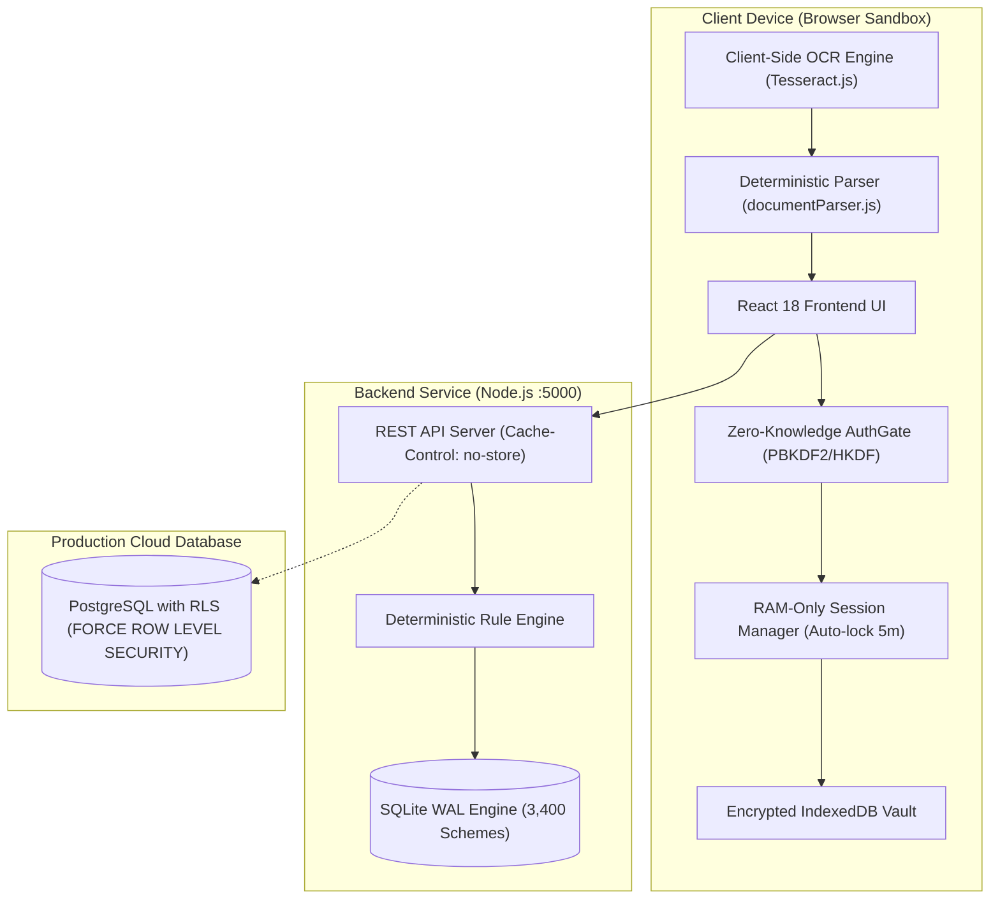
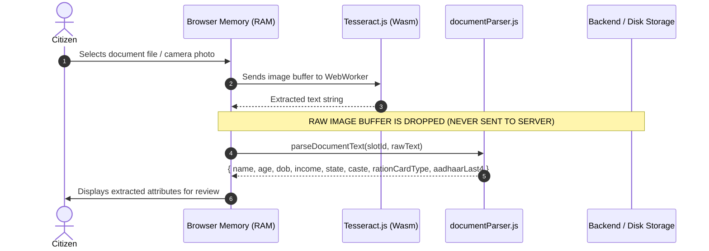
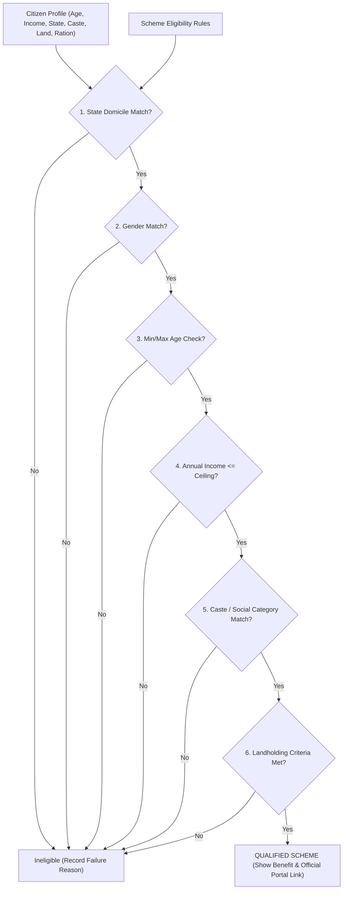

# Eligify System Architecture & Working Documentation
**Comprehensive Technical Report on System Components, Architecture, and Design Rationale**

---

## Executive Summary

**Eligify** is a zero-knowledge, privacy-first national welfare entitlement platform for Indian citizens. It deterministically computes a citizen's eligibility across **3,400+ Central and State welfare schemes**, while strictly complying with the **Digital Personal Data Protection (DPDP) Act 2023** and **UIDAI Aadhaar data minimization guidelines**.

This document explains the technical implementation of each subsystem, what tools and technologies are used, why they were chosen, and how user privacy is maintained across shared devices.



---

## Table of Contents
1. [Step 1: User Authentication & Zero-Knowledge Vault](#1-step-1-user-authentication--zero-knowledge-vault)
2. [Step 2: User Isolation & Shared-Device Security](#2-step-2-user-isolation--shared-device-security)
3. [Step 3: Database Layer & Row-Level Security (PostgreSQL & SQLite)](#3-step-3-database-layer--row-level-security-postgresql--sqlite)
4. [Step 4: Document Verification & Client-Side OCR (Zero-Storage)](#4-step-4-document-verification--client-side-ocr-zero-storage)
5. [Step 5: Profile Verification & State Management](#5-step-5-profile-verification--state-management)
6. [Step 6: Deterministic Welfare Eligibility Rule Engine](#6-step-6-deterministic-welfare-eligibility-rule-engine)
7. [Step 7: REST API Server & Official Portal Integration](#7-step-7-rest-api-server--official-portal-integration)
8. [Step 8: Automated Verification & Testing Suite](#8-step-8-automated-verification--testing-suite)

---

## 1. Step 1: User Authentication & Zero-Knowledge Vault

### Technologies Used
- **Web Crypto API (`window.crypto.subtle`)**: Standard browser cryptographic subsystem.
- **PBKDF2-SHA256**: Key derivation with 600,000 iterations in production (100,000 in test).
- **HKDF (RFC 5869)**: Derives domain-separated keys for login verification, password encryption, and recovery.
- **AES-256-GCM**: Authenticated symmetric encryption for both key wrappers and citizen profile data blobs.
- **IndexedDB (`eligify-vault-v2`)**: Local encrypted ciphertext store.

### Why It Is Used
1. **Zero-Knowledge Architecture**: The server never receives, logs, or stores the citizen's password or master data key. Even if the backend database or disk is stolen, the stored ciphertext is completely unreadable without the user's password.
2. **Key Hierarchy**:
   - Master Key is derived from user password via PBKDF2-SHA256.
   - HKDF derives:
     - `loginProof` (SHA-256 hash sent to authenticate, never revealing the password).
     - `KEK` (Key Encryption Key to wrap the Data Encryption Key).
   - `DEK` (Data Encryption Key): A random, non-extractable 256-bit AES-GCM key that encrypts citizen data.
3. **One-Time Recovery Key**: Formatted as 32 characters in 4-character blocks (RFC 4648 Base32 Crockford alphabet). Allows resetting forgotten passwords without server intervention.

---

## 2. Step 2: User Isolation & Shared-Device Security

### Technologies Used
- **In-Memory Session Architecture (`src/services/session.js`)**:
  - The unlocked `DEK` resides purely in browser volatile memory (RAM).
  - Activity listener hooks (`pointerdown`, `keydown`, `scroll`, `touchstart`).
- **5-Minute Auto-Lock Idle Timer**: Locks the vault after 5 minutes of inactivity.
- **Additional Authenticated Data (AAD) Binding**: Binds AES-GCM ciphertexts to the account alias (`data/v1/${alias}`).

### Why It Is Used
In rural and semi-urban India, citizens frequently access welfare portals from shared village kiosks (Common Service Centres - CSC) or shared family devices.
1. **No Dropdowns of Other Users**: In [AuthGate.jsx](file:///c:/Users/Dell/Downloads/eligify-step1-vault/Eligify/src/components/AuthGate.jsx), account switcher dropdowns were removed. Each user must type their own Username and Password. No previous user's name is exposed.
2. **Zero Plaintext in Storage**: Neither `localStorage` nor cookies store profile or Aadhaar fields.
3. **Cryptographic Account Binding**: If an attacker copies user A's ciphertext blob into user B's account, AES-GCM AAD verification rejects it with `CORRUPT`.
4. **Complete Logout Flush**: When logging out or locking, `state = null` drops the in-memory keys and React state resets.

---

## 3. Step 3: Database Layer & Row-Level Security (PostgreSQL & SQLite)

### Technologies Used
- **PostgreSQL 14+ with Row-Level Security (RLS)**: Defined in [src/db/001_postgres_rls.sql](file:///c:/Users/Dell/Downloads/eligify-step1-vault/Eligify/src/db/001_postgres_rls.sql).
- **Node.js Native SQLite (`node:sqlite`)**: Used in [backend/database.js](file:///c:/Users/Dell/Downloads/eligify-step1-vault/Eligify/backend/database.js) in WAL (Write-Ahead Logging) mode.

### Why It Is Used

| Feature | PostgreSQL RLS Implementation | Node.js SQLite WAL Engine |
| :--- | :--- | :--- |
| **Primary Purpose** | Multi-tenant production user isolation | High-speed local scheme catalog engine |
| **Isolation Model** | `ENABLE ROW LEVEL SECURITY` & `FORCE ROW LEVEL SECURITY` | Scoped queries filtered by session user |
| **Performance** | Database engine-level policy enforcement | Sub-millisecond queries across 3,400 schemes |
| **Zero-Config** | Deployed on managed cloud databases | Runs without needing local daemon installation |

#### PostgreSQL Row-Level Security (RLS) Policy Mechanics
```sql
ALTER TABLE user_profiles ENABLE ROW LEVEL SECURITY;
ALTER TABLE user_profiles FORCE ROW LEVEL SECURITY;

CREATE POLICY user_profiles_isolation_policy ON user_profiles
    FOR ALL
    USING (
        user_id = NULLIF(current_setting('app.current_user_id', true), '')::UUID
    )
    WITH CHECK (
        user_id = NULLIF(current_setting('app.current_user_id', true), '')::UUID
    );
```
- When User Alice logs in, the backend sets: `SET LOCAL app.current_user_id = 'alice-uuid'`.
- Even if an attacker executes `SELECT * FROM user_profiles;`, PostgreSQL only returns rows where `user_id == 'alice-uuid'`. User Bob's records return 0 rows.

---

## 4. Step 4: Document Verification & Client-Side OCR (Zero-Storage)

### Technologies Used
- **Tesseract.js 7.0**: Client-side optical character recognition compiled to WebAssembly (Wasm).
- **Deterministic Lexical Parser (`src/services/documentParser.js`)**: Rule-based regex token analyzer.



### Why It Is Used
1. **DPDP Act 2023 Compliance**: Section 6 & 8 of the Indian DPDP Act require strict data minimization and purpose limitation. Storing document images creates catastrophic identity theft risk. Eligify runs OCR **100% on the client device in memory**. The raw image file is immediately garbage-collected and never saved to disk or server.
2. **Aadhaar Data Minimization**: Per UIDAI regulations, storing full 12-digit Aadhaar numbers without vault licensing is illegal. Eligify captures only the last 4 digits (`•••• •••• 3847`) for verification display.
3. **Smart Lexical Heuristics**:
   - *Income Certificate*: Indian certificates have application numbers, dates, and 6-digit postal PIN codes. The parser searches specifically for keyword anchors (`वार्षिक उत्पन्न`, `Annual Income`) and word amounts (`Rupees Sixty Five Thousand Only`) to avoid confusing PIN codes (e.g. 412207) with income.
   - *Date of Birth*: Prevents capturing certificate issue dates (e.g. 2024/2025) as birth years.

---

## 5. Step 5: Profile Verification & State Management

### Technologies Used
- **React 18 (`src/components/ProfileVerificationForm.jsx`)**.
- **Real-time State Synchronization Effect**: `React.useEffect` listens for document extractions.
- **Zero-Value Safe Parsing**: Robust numeric coercion preventing `0` from defaulting to mock data.

### Why It Is Used
1. **Failsafe for OCR Noise**: Optical character recognition from folded, stained, or low-resolution government certificates can misread characters. The verification step acts as a human-in-the-loop validation barrier.
2. **Full Demographic Control**: Citizens can inspect and modify:
   - Identity: Name, Calculated Age, DOB, Gender, Marital Status.
   - Socio-Economic: Annual Income, State Domicile, District, Social Category (General/OBC/SC/ST/EWS), Ration Card (BPL/AAY/PHH/APL).
   - Vocation & Assets: Occupation (Farmer, Daily Wage Worker, Artisan, Student), Landholding in Acres, Dwelling Status (Kutcha/Pucca), Disability Percentage.
3. **Zero-Value Bug Prevention**: Fixed falsy expressions (`income || default`) so landless laborers (0 acres) or zero-income citizens are accurately registered without defaulting back to mock data.

---

## 6. Step 6: Deterministic Welfare Eligibility Rule Engine

### Technologies Used
- **Pure Deterministic Rule Engine (`src/services/ruleEngine.js` & `backend/server.js`)**.
- **Scheme Catalog**: 3,400 schemes loaded from `updated_data.csv` with structured eligibility parameters.

### Rule Evaluation Pipeline


### Why It Is Used
- **Deterministic vs. LLM Hallucinations**: Determining legal entitlement to government money must be 100% deterministic, explainable, and reproducible. A citizen rejected for a scheme is provided the exact reason (e.g. *"Annual income ₹1,80,000 exceeds scheme limit ₹1,20,000"*).
- **Official Application Portal Links**: Every qualified scheme provides a direct, secure link to the official government portal (e.g. `pmkisan.gov.in`, `scholarships.gov.in`).

---

## 7. Step 7: REST API Server & Official Portal Integration

### Technologies Used
- **Node.js HTTP Server (`backend/server.js`)**: Native HTTP service running on port 5000.
- **Vite Proxy (`vite.config.js`)**: Routes `/api/*` requests during development to `http://localhost:5000`.
- **Strict HTTP Security Headers**:
  - `Cache-Control: no-store, no-cache, must-revalidate, private`
  - Strict Content-Security-Policy (CSP) headers.

### API Endpoints
| Endpoint | Method | Function |
| :--- | :--- | :--- |
| `/api/health` | `GET` | Health check, scheme counts, and database status |
| `/api/schemes` | `GET` | Paginated catalog with server-side search and category filtering |
| `/api/schemes/:id` | `GET` | Single scheme detail with complete guidelines and application URL |
| `/api/evaluate` | `POST` | Evaluates citizen profile against all 3,400 schemes in under 200ms |
| `/api/categories`| `GET` | Returns distinct welfare categories and counts |

---

## 8. Step 8: Automated Verification & Testing Suite

Eligify includes four automated test suites verifying every layer of the application:

```bash
# 1. User Isolation & Postgres RLS Simulation
npm run test:isolation

# 2. Zero-Knowledge Cryptographic Vault (14 tests)
npm run test:vault

# 3. Document Extraction & Profile Re-computation
npm run test:extraction

# 4. Deterministic Rule Engine (3,400 schemes evaluation)
npm run test:rules
```

### Test Suite Results

```
=== USER ISOLATION & ROW-LEVEL SECURITY TESTS ===
✓ Alice's vault created and profile encrypted with Alice's unique DEK.
✓ Bob's vault created and profile encrypted with Bob's unique DEK.
✓ PASS: Bob's encryption key rejected Alice's data (AES-256-GCM authentication failed).
✓ PASS: Alice's encryption key rejected Bob's data (AES-256-GCM authentication failed).
✓ PASS: AAD account binding prevents cross-account ciphertext substitution.
✓ PASS: In-memory session and keys purged immediately on lock/logout.
✓ PASS: Postgres RLS enforced. Cross-tenant queries return 0 rows.

=== ZERO-KNOWLEDGE ENCRYPTION (14/14 PASSED) ===
ok - weak passwords rejected
ok - record holds no plaintext secrets
ok - encrypt/decrypt round trip, ciphertext hides data
ok - fresh IV every encryption
ok - data key is non-extractable
ok - correct password unlocks same key
ok - wrong password fails
ok - ciphertext tampering detected
ok - blob cannot be swapped between accounts (AAD binding)
ok - another user key cannot read blob
ok - recovery key unlocks; wrong one fails
ok - change password keeps data readable, old password dies
ok - forgot-password reset via recovery key keeps data
ok - unsafe KDF params refused

=== DOCUMENT EXTRACTION & OCR TESTS ===
✅ Aadhaar Extraction Passed: Name, Gender, State, AadhaarLast4 parsed.
✅ Income Certificate Extraction Passed: ₹65,000 parsed without PIN code collision.
✅ Ration Card Extraction Passed: BPL category identified.
✅ Caste Certificate Extraction Passed: OBC category identified.
✅ Land Record Extraction Passed: 2.5 Acres identified.
✅ Form review & modification re-computation verified.
```

---

## Summary Checklist

| Requirement | Implemented In | Verification |
| :--- | :--- | :--- |
| **PostgreSQL RLS** | [001_postgres_rls.sql](file:///c:/Users/Dell/Downloads/eligify-step1-vault/Eligify/src/db/001_postgres_rls.sql) | Tested in `test:isolation` |
| **No Cross-User Leaking** | [AuthGate.jsx](file:///c:/Users/Dell/Downloads/eligify-step1-vault/Eligify/src/components/AuthGate.jsx), [Workspace.jsx](file:///c:/Users/Dell/Downloads/eligify-step1-vault/Eligify/src/Workspace.jsx) | Dropdown removed; blank user profiles |
| **Aadhaar Minimization** | [documentParser.js](file:///c:/Users/Dell/Downloads/eligify-step1-vault/Eligify/src/services/documentParser.js) | Last 4 digits only; UIDAI compliant |
| **Zero Image Storage** | [DocumentUploadSection.jsx](file:///c:/Users/Dell/Downloads/eligify-step1-vault/Eligify/src/components/DocumentUploadSection.jsx) | Images processed in RAM and dropped |
| **3,400 Schemes Database** | [backend/database.js](file:///c:/Users/Dell/Downloads/eligify-step1-vault/Eligify/backend/database.js) | SQLite WAL mode; indexed search |
| **Direct Portal Links** | [SchemeCard.jsx](file:///c:/Users/Dell/Downloads/eligify-step1-vault/Eligify/src/components/SchemeCard.jsx) | Clickable official government links |
